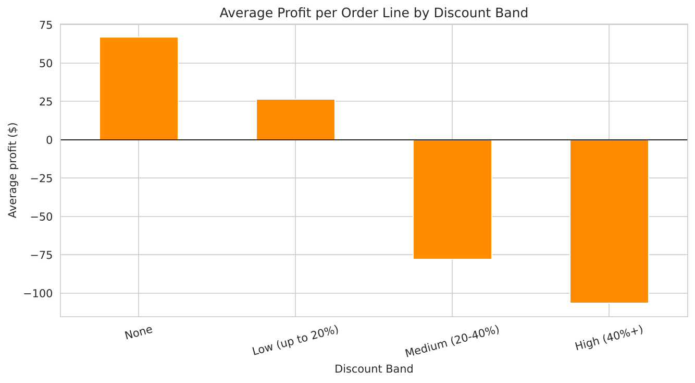
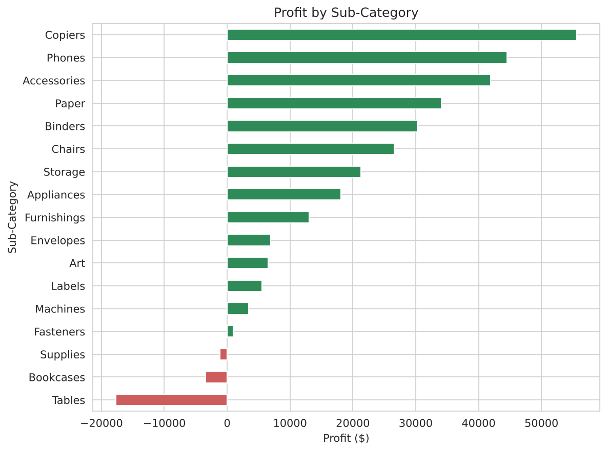
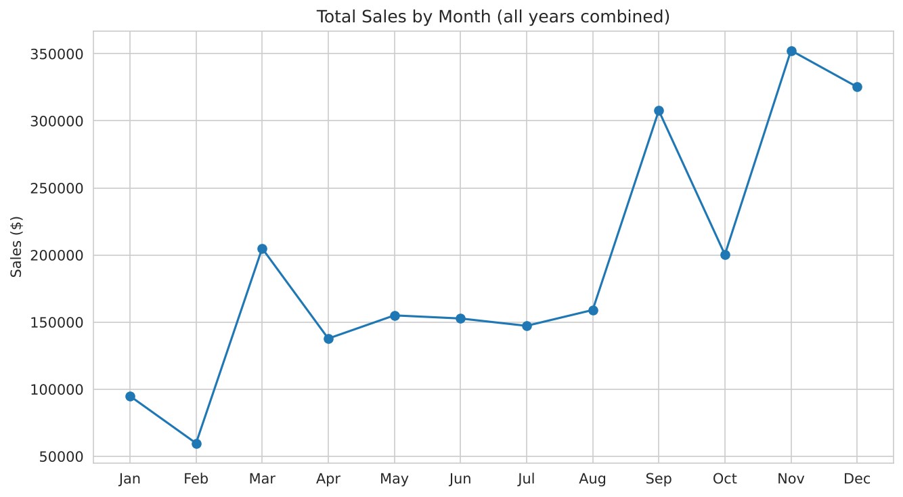

# Retail Sales Analysis: Superstore Dataset

An exploratory data analysis of a retail store's orders (2014–2017) in **Python** and **SQL**, to find out what drives and what hurts profit, and to turn the findings into business recommendations.

**Tools:** Python · Pandas · Matplotlib · Seaborn · SQL (SQLite) · Jupyter Notebook

## Key finding

> **Heavy discounting is the biggest profit leak.** Order lines with no discount earn about **+$67** profit on average, but lines discounted more than 20% lose money: **−$78** per line at 20–40% and **−$107** above 40%.



## Business questions

1. Which categories and sub-categories earn the most profit, and which lose money?
2. How do sales change over time (yearly growth and seasonality)?
3. Which regions and states underperform?
4. How does discount level affect profit?
5. Who are the top customers, and are they profitable?

## Dataset

- **Source:** Superstore Sales Dataset, a public sample dataset widely available on Kaggle (a copy is included in `data/superstore.csv`)
- **Size:** 9,994 order lines, 21 columns, covering 2014–2017
- **Contents:** order and ship dates, customer, segment, region, state, product category and sub-category, sales, quantity, discount, profit
- **Quality:** no duplicates and no missing values; amounts are in US dollars

## Results

**Overall:** about $2.30M in sales and $286K in profit (12.5% margin) across 5,009 orders.

| Question | What I found |
|---|---|
| **Categories** | Technology ($145K profit) and Office Supplies ($122K) lead. Furniture earns only $18K on $742K of sales, a **2.5% margin** vs. about 17% for the others. |
| **Loss-making products** | Tables (−$17.7K), Bookcases (−$3.5K) and Supplies (−$1.2K) lose money overall. |
| **Growth and seasonality** | Sales fell 2.8% in 2015, then grew **29.5%** in 2016 and **20.4%** in 2017. September, November and December are the peak months; Nov + Dec alone are about 30% of sales. |
| **Regions and states** | West (14.9% margin) and East (13.5%) lead; Central is weakest (7.9%). Texas, Ohio, Pennsylvania and Illinois lose about **$71K combined**. |
| **Discounts** | Those four states average 32–39% discounts, against 15.6% company-wide and 7.3% in California. About **72%** of loss-making order lines carry a discount of 30% or more. |
| **Customers** | The top customer by sales (Sean Miller, $25K) has a net *loss* of about $2K. 17 customers with over $5K in sales are unprofitable. |

<p float="left">
  
  
</p>

## Recommendations

1. **Cap discounts at 20%** and require review for anything above it, starting with Furniture.
2. **Reprice or stop discounting Tables**, and review Bookcases.
3. **Review the discount policy in TX, OH, PA and IL**, where heavy discounting goes with large losses.
4. **Plan stock and promotions around September to December**, and consider campaigns to lift January and February.
5. **Track customer profit, not just revenue**, and review terms for high-sales customers who lose money.

## Limitations

This is a sample dataset, so the analysis shows association rather than proof of cause. For example, a product may have been discounted because it was already underperforming. The data covers four years of one retailer and may not generalize.

## Project structure

```
superstore-sales-analysis/
├── data/
│   └── superstore.csv                 # dataset
├── images/                            # charts exported from the notebook
├── sql/
│   ├── load_to_sqlite.py              # loads the CSV into a SQLite database
│   └── queries.sql                    # 12 queries (aggregations, CTEs, window functions)
├── superstore_sales_analysis.ipynb    # full analysis with outputs
├── requirements.txt
└── README.md
```

## How to run

**Python analysis**

```bash
git clone <https://github.com/ritviksinha1/superstore-sales-analysis>
cd superstore-sales-analysis
pip install -r requirements.txt
jupyter notebook superstore_sales_analysis.ipynb
```

Then choose **Kernel → Restart & Run All**. Charts are also saved to `images/`.

**SQL queries**

```bash
python sql/load_to_sqlite.py
```

This creates `superstore.db`. Open it in any SQLite client (for example DB Browser for SQLite or the VS Code SQLite extension) and run the queries in `sql/queries.sql`.

The SQL file answers the same questions as the notebook and uses `GROUP BY` / `HAVING`, `CASE`, CTEs, and window functions (`LAG`, `RANK`, `RANK() OVER (PARTITION BY ...)`, running totals with `SUM() OVER`).

## Next steps

- Build an interactive Power BI or Tableau dashboard from the same data
- Forecast monthly sales
- Test the discount findings more rigorously, for example by comparing similar products with and without discounts

## Author

**[Ritvik Sinha]**: [LinkedIn](https://www.linkedin.com/in/sinharitvik) · [Email](mailto:ritviksinha101@gmail.com)
